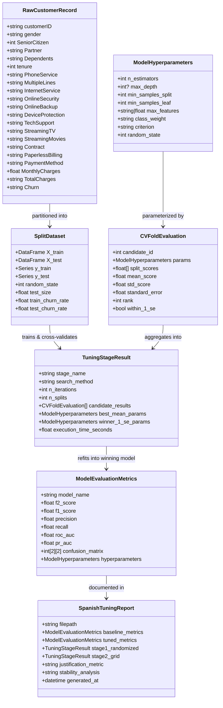
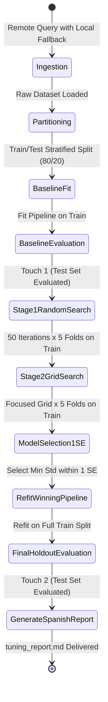

# Phase 1 Data Model: Systematic Churn Model Hyperparameter Tuning

**Branch**: `001-tune-churn-model`  
**Feature**: Systematic Churn Model Hyperparameter Tuning  
**Date**: 2026-11-17  
**Status**: Complete  

---

## Entity Relationship Overview

---

## Detailed Entity Definitions

### 1. `RawCustomerRecord`
Represents the schema of individual subscriber rows ingested from the IBM Telco Customer Churn dataset.

| Field | Type | Required | Validation / Description |
|---|---|---|---|
| `customerID` | string | Yes | Unique customer identifier (e.g. `7590-VHVEG`). Dropped prior to model training. |
| `gender` | string | Yes | Category: `['Male', 'Female']`. |
| `SeniorCitizen` | int | Yes | Binary integer: `0` or `1`. |
| `Partner` | string | Yes | Category: `['Yes', 'No']`. |
| `Dependents` | string | Yes | Category: `['Yes', 'No']`. |
| `tenure` | int | Yes | Non-negative integer indicating number of subscription months ($0 \le \text{tenure} \le 72$). |
| `PhoneService` | string | Yes | Category: `['Yes', 'No']`. |
| `MultipleLines` | string | Yes | Category: `['Yes', 'No', 'No phone service']`. |
| `InternetService` | string | Yes | Category: `['DSL', 'Fiber optic', 'No']`. |
| `OnlineSecurity` | string | Yes | Category: `['Yes', 'No', 'No internet service']`. |
| `OnlineBackup` | string | Yes | Category: `['Yes', 'No', 'No internet service']`. |
| `DeviceProtection` | string | Yes | Category: `['Yes', 'No', 'No internet service']`. |
| `TechSupport` | string | Yes | Category: `['Yes', 'No', 'No internet service']`. |
| `StreamingTV` | string | Yes | Category: `['Yes', 'No', 'No internet service']`. |
| `StreamingMovies` | string | Yes | Category: `['Yes', 'No', 'No internet service']`. |
| `Contract` | string | Yes | Category: `['Month-to-month', 'One year', 'Two year']`. |
| `PaperlessBilling` | string | Yes | Category: `['Yes', 'No']`. |
| `PaymentMethod` | string | Yes | Category: `['Electronic check', 'Mailed check', 'Bank transfer (automatic)', 'Credit card (automatic)']`. |
| `MonthlyCharges` | float | Yes | Numeric charge per month ($18.0 \le \text{MonthlyCharges} \le 120.0$). |
| `TotalCharges` | string / float | Yes | Cumulative charge string. Contains blank spaces `" "` for brand-new subscribers (`tenure == 0`). Must be coerced to `0.0`. |
| `Churn` | string | Yes | Target label: `['Yes', 'No']`. Converted to binary integer `1` (Yes) or `0` (No). |

---

### 2. `SplitDataset`
Encapsulates stratified data splits and leakage boundary constraints.

| Field | Type | Description |
|---|---|---|
| `X_train` | `pandas.DataFrame` | Feature matrix for model training and cross-validation ($N \approx 5,634$). |
| `y_train` | `pandas.Series` | Binary churn target for training split ($y \in \{0, 1\}$). |
| `X_test` | `pandas.DataFrame` | Feature matrix for holdout test split ($N \approx 1,409$). Touched exactly twice. |
| `y_test` | `pandas.Series` | Binary churn target for holdout test split. |
| `random_state` | int | Fixed seed (`42`) ensuring deterministic split. |
| `test_size` | float | Test proportion (`0.20`). |
| `train_churn_rate` | float | Monitored stratified positive class ratio ($\approx 26.5\%$). |
| `test_churn_rate` | float | Monitored stratified positive class ratio ($\approx 26.5\%$). |

---

### 3. `ModelHyperparameters`
Represents candidate or selected parameter configurations for the `RandomForestClassifier` pipeline stage.

| Field | Type | Allowed Range / Values | Default (Baseline) |
|---|---|---|---|
| `n_estimators` | int | $[50, 600]$ | `100` |
| `max_depth` | int or null | `[null, 3, 5, 8, 12, 16, 20]` | `null` (None) |
| `min_samples_split` | int | $[2, 30]$ | `2` |
| `min_samples_leaf` | int | $[1, 20]$ | `1` |
| `max_features` | string, float, null | `['sqrt', 'log2', 0.2, 0.4, 0.6]` | `'sqrt'` |
| `class_weight` | string, dict, null | `['balanced', 'balanced_subsample']` | `null` (in baseline) / `'balanced'` |
| `criterion` | string | `['gini', 'entropy']` | `'gini'` |
| `random_state` | int | Fixed seed (`42`) | `42` |

---

### 4. `CVFoldEvaluation`
Captures detailed cross-validation distribution metrics for each evaluated hyperparameter candidate.

| Field | Type | Description / Formula |
|---|---|---|
| `candidate_id` | int | Unique index of the evaluated parameter setting within the search. |
| `params` | `ModelHyperparameters` | Exact hyperparameter key-value mapping. |
| `split_scores` | float array | Array of size $k=5$ containing $F_2$ scores on each validation fold. |
| `mean_score` | float | Arithmetic mean across folds: $\bar{S} = \frac{1}{k} \sum_{i=1}^k S_i$. |
| `std_score` | float | Sample standard deviation: $\sigma = \sqrt{\frac{1}{k-1} \sum_{i=1}^k (S_i - \bar{S})^2}$. |
| `standard_error` | float | Standard error of the mean: $\text{SE} = \frac{\sigma}{\sqrt{k}}$. |
| `rank` | int | Ordinal rank by `mean_score` descending. |
| `within_1_se` | bool | True if $\bar{S} \ge \bar{S}_{\max} - \text{SE}_{\max}$. |

---

### 5. `TuningStageResult`
Stores the full artifact from an optimization stage.

| Field | Type | Description |
|---|---|---|
| `stage_name` | string | `"stage1_randomized"` or `"stage2_grid"`. |
| `search_method` | string | `"RandomizedSearchCV"` or `"GridSearchCV"`. |
| `n_iterations` | int | Total parameter configurations evaluated (50 for Stage 1, focused grid count for Stage 2). |
| `n_splits` | int | Number of CV folds ($k=5$). |
| `candidate_results` | `CVFoldEvaluation[]` | Full table of evaluated configurations. |
| `best_mean_params` | `ModelHyperparameters` | Configuration with the highest mean $F_2$ score. |
| `winner_1_se_params` | `ModelHyperparameters` | Configuration selected via the 1-SE rule (lowest fold std within 1 SE of top mean). |
| `execution_time_seconds` | float | Total search runtime. |

---

### 6. `ModelEvaluationMetrics`
Encapsulates test set performance for comparison.

| Field | Type | Metric Definition |
|---|---|---|
| `model_name` | string | `"Baseline (Default)"` or `"Tuned (1-SE Winner)"`. |
| `f2_score` | float | $F_2 = 5 \cdot \frac{P \cdot R}{4P + R}$ on Churn positive class (`1`). |
| `f1_score` | float | Harmonic mean of Precision and Recall. |
| `precision` | float | $\frac{TP}{TP + FP}$ on positive class. |
| `recall` | float | $\frac{TP}{TP + FN}$ on positive class. |
| `roc_auc` | float | Area under ROC Curve computed with predicted probabilities. |
| `pr_auc` | float | Area under Precision-Recall Curve (`average_precision_score`). |
| `confusion_matrix` | int[2][2] | `[[TN, FP], [FN, TP]]`. |
| `hyperparameters` | `ModelHyperparameters` | Estimator hyperparameters used during inference. |

---

### 7. `SpanishTuningReport`
Represents the markdown document structure required by FR-012.

| Section | Target Language | Contents |
|---|---|---|
| **Resumen Ejecutivo** | Spanish | Comparative test metric table (Baseline vs. Tuned), confusion matrices, improvement percentages. |
| **Justificación de la Métrica de Negocio** | Spanish | Mathematical definition of $F_2$ ($\beta=2$), rationale for asymmetric cost weighting in customer churn, comparison vs. $F_1$ and Accuracy. |
| **Espacio de Búsqueda y Ajuste en 2 Fases** | Spanish | Phase 1 distributions, Phase 2 focused grid ranges, refitting details, best parameters table. |
| **Análisis de Estabilidad y Criterio 1-SE** | Spanish | Mean vs. variance table across top candidate models, explanation of the 1-SE decision boundary, trade-off justification. |

---

## State Transition Lifecycle

